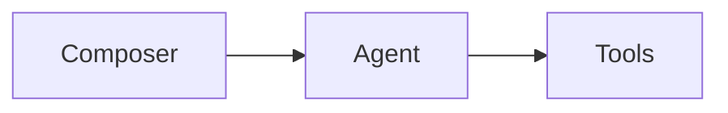

As respostas são renderizadas como Markdown no estilo do GitHub. A formatação chega conforme o
texto chega, então uma tabela ou um bloco de código pode parecer incompleto por um instante antes
de fechar.

## Sintaxe suportada

| Recurso | Exemplo |
| --- | --- |
| Títulos, listas, negrito, itálico, riscado | Markdown padrão |
| Tabelas | Tabelas com pipe, roláveis quando largas |
| Listas de tarefas | `- [x] done` |
| Notas de rodapé | `[^1]` com uma seção **Notas** no final |
| Links automáticos | URLs soltas viram links |
| Alertas do GitHub | `> [!NOTE]`, `[!TIP]`, `[!IMPORTANT]`, `[!WARNING]`, `[!CAUTION]` |
| HTML inline | Um subconjunto seguro: `<mark>`, `<kbd>`, `<sup>`, `<sub>`, `<details>` |
| Matemática | `$inline$` e `$$block$$` via KaTeX |
| Diagramas | blocos ` ```mermaid ` |
| Código | Blocos cercados com destaque de linguagem e **Copiar código** |

## Matemática

Matemática inline usa um cifrão, matemática em bloco usa dois:

```markdown
The growth rate is $r = \frac{V_f - V_i}{V_i}$.

$$
P(A \mid B) = \frac{P(B \mid A)\,P(A)}{P(B)}
$$
```

O KaTeX renderiza localmente; nenhum serviço externo é envolvido.

## Diagramas

````markdown

````

O Mermaid roda com `securityLevel: strict`: handlers de clique e scripts dentro de um diagrama
ficam desativados. Sintaxe não suportada mostra o código do diagrama em vez de quebrar a
mensagem.

## Código

Blocos cercados recebem destaque para 30+ linguagens e ganham um botão **Copiar código**. Linhas
longas rolam na horizontal dentro do bloco; o resto da mensagem mantém a largura.

## HTML, SVG e gráficos

Três cercas extras ganham prévia:

| Cerca | Resultado |
| --- | --- |
| `html` | Renderizado em um iframe isolado (sem scripts, sem acesso ao app) |
| `svg` | Renderizado inline, saneado |
| `chart` | Dados JSON renderizados como gráfico SVG |

Use quando você pediu uma página pequena, um ícone ou um gráfico rápido e quer ver o resultado sem
salvar um arquivo. Para qualquer coisa que você precise manter, peça um artefato — veja
[Artefatos](/docs/artifacts).

## Segurança

HTML cru em uma resposta passa por uma lista de permissões: scripts, iframes, handlers de evento e
blocos de estilo são removidos, `srcset` é descartado, e os links abrem no seu navegador padrão em
vez de dentro do app. As imagens carregam sob demanda.

Isso vale para tudo o que o modelo escreve, inclusive conteúdo copiado de uma página que ele leu.
Trate a saída formatada como a renderização de um texto não confiável, não como um documento
confiável.

## Dicas

- Peça uma tabela quando for comparar três ou mais coisas; ela continua legível na transcrição.
- Peça um diagrama Mermaid ao explicar um fluxo; fica mais fácil de conferir que a prosa.
- Se a matemática parecer errada, confira os delimitadores: `$...$` não pode conter uma linha em
  branco.
- Copiar um bloco com **Copiar código** preserva a indentação; selecionar com o mouse nem sempre
  preserva.

Próximo: [Execução de código](/docs/code-execution).
