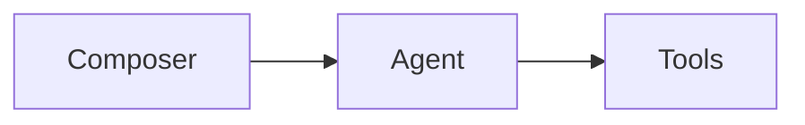

回答按 GitHub 风格的 Markdown 渲染。格式随文本流式到达，所以表格或代码块在收尾前可能短暂
显得不完整。

## 支持的语法

| 功能 | 示例 |
| --- | --- |
| 标题、列表、粗体、斜体、删除线 | 标准 Markdown |
| 表格 | 管道表格，过宽时可滚动 |
| 任务列表 | `- [x] done` |
| 脚注 | `[^1]`，末尾生成 **注释** 区块 |
| 自动链接 | 裸 URL 会变成链接 |
| GitHub 提示块 | `> [!NOTE]`、`[!TIP]`、`[!IMPORTANT]`、`[!WARNING]`、`[!CAUTION]` |
| 行内 HTML | 一个安全子集：`<mark>`、`<kbd>`、`<sup>`、`<sub>`、`<details>` |
| 数学公式 | `$inline$` 和 `$$block$$`，由 KaTeX 渲染 |
| 图表 | ` ```mermaid ` 区块 |
| 代码 | 围栏代码块，带语言高亮和 **复制代码** |

## 数学公式

行内公式用单个美元符号，块级公式用两个：

```markdown
The growth rate is $r = \frac{V_f - V_i}{V_i}$.

$$
P(A \mid B) = \frac{P(B \mid A)\,P(A)}{P(B)}
$$
```

KaTeX 在本地渲染，不涉及任何外部服务。

## 图表

````markdown

````

Mermaid 以 `securityLevel: strict` 运行：图表内的点击处理器和脚本都会被禁用。语法不支持时
会显示图表源码，而不是让消息出错。

## 代码

围栏代码块支持 30+ 种语言的语法高亮，并带有 **复制代码** 按钮。过长的行在代码块内横向滚
动；消息其余部分保持原有宽度。

## HTML、SVG 与图表

有三种额外围栏会得到预览：

| 围栏 | 结果 |
| --- | --- |
| `html` | 在沙箱 iframe 中渲染（无脚本，无法访问应用） |
| `svg` | 直接内联渲染，并做清理 |
| `chart` | 以 JSON 数据渲染为 SVG 图表 |

当你只是要一个小页面、一个图标或一张快速图形，想直接看到而不保存文件时，可以用它们。任何
需要留存的内容，请改为索要产物——参见
[产物](/docs/artifacts)。

## 安全

回答中的原始 HTML 会经过白名单过滤：脚本、iframe、事件处理器和样式块都会被移除，`srcset`
会被丢弃，链接在你的默认浏览器中打开而不是在应用内打开。图片按需延迟加载。

这条规则适用于模型写出的所有内容，包括它从读过网页中复制来的内容。请把格式化输出当作不可
信文本的渲染结果，而不是可信文档。

## 提示

- 对比三件以上事物时索要表格；它在对话记录里依然好读。
- 讲解流程时索要 Mermaid 图表；它比整段文字更好核对。
- 如果公式看起来不对，检查分隔符：`$...$` 中不能有空行。
- 用 **复制代码** 复制代码块会保留缩进；用鼠标手动选取则不一定。

下一步：[代码执行](/docs/code-execution)。
